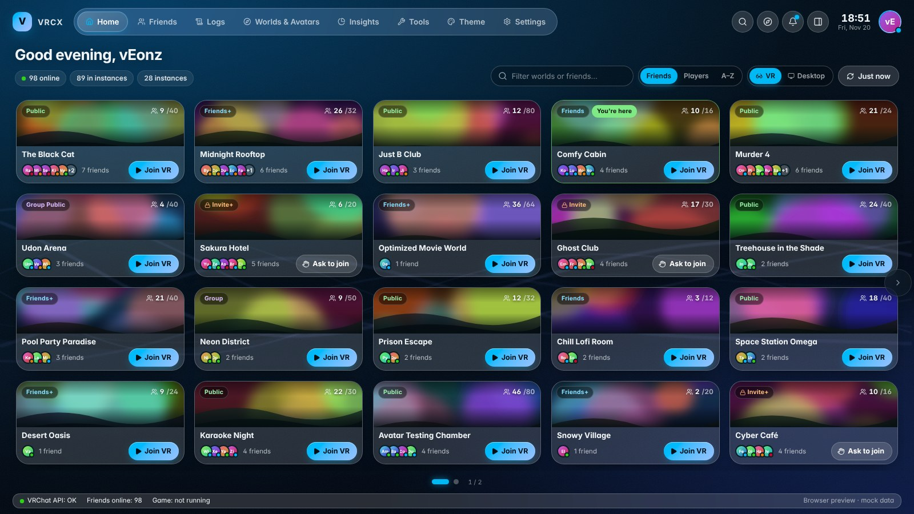
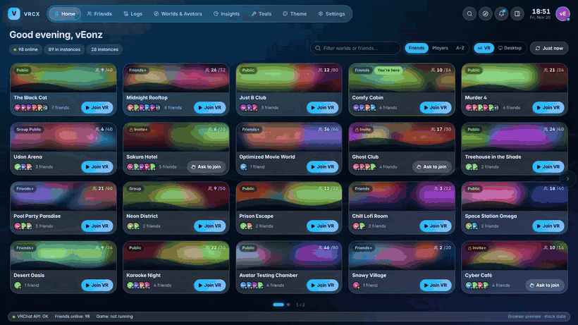
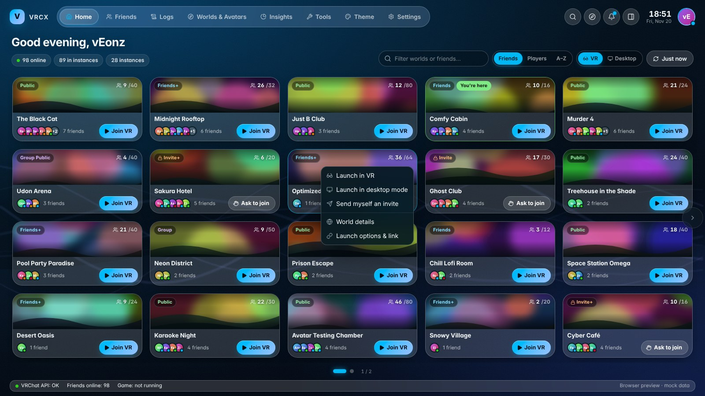
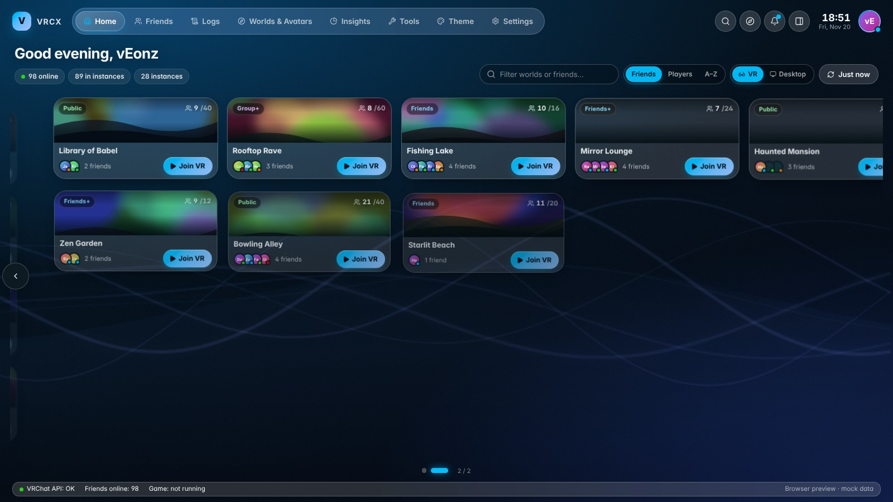
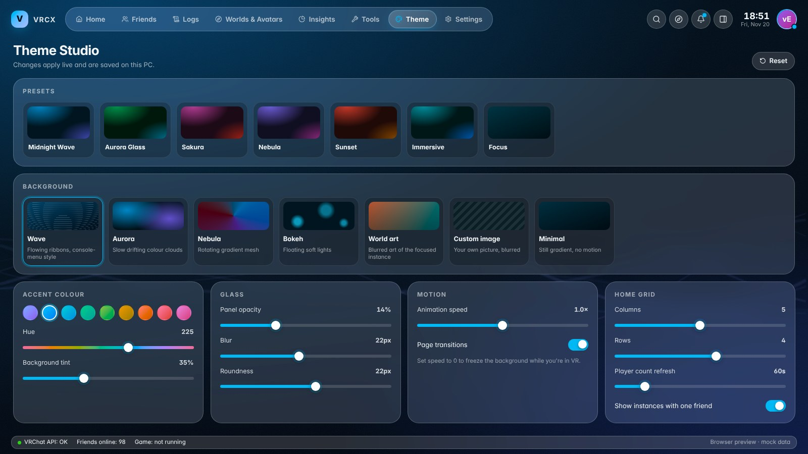
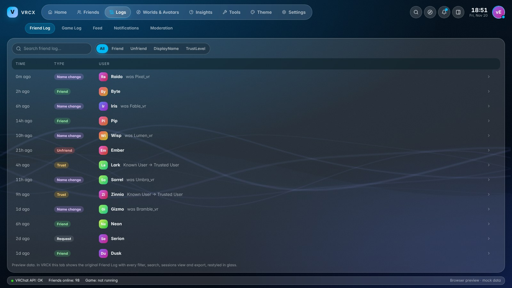
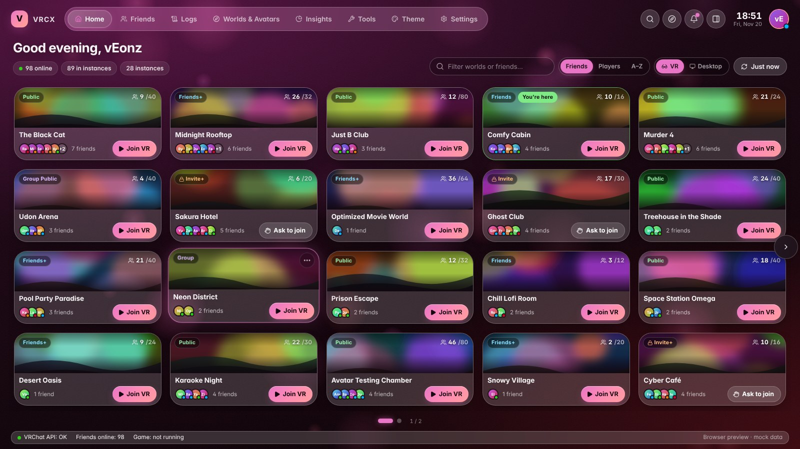
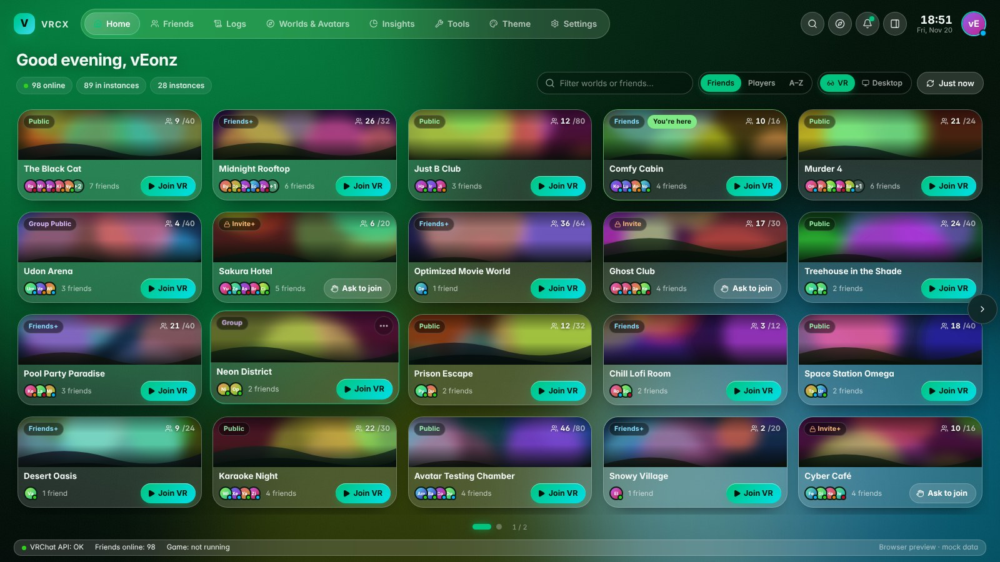
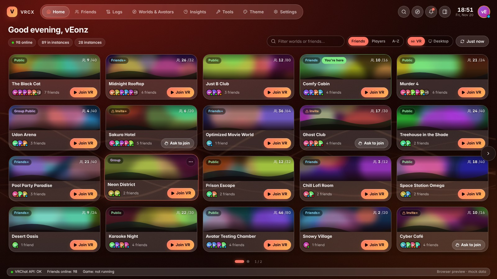
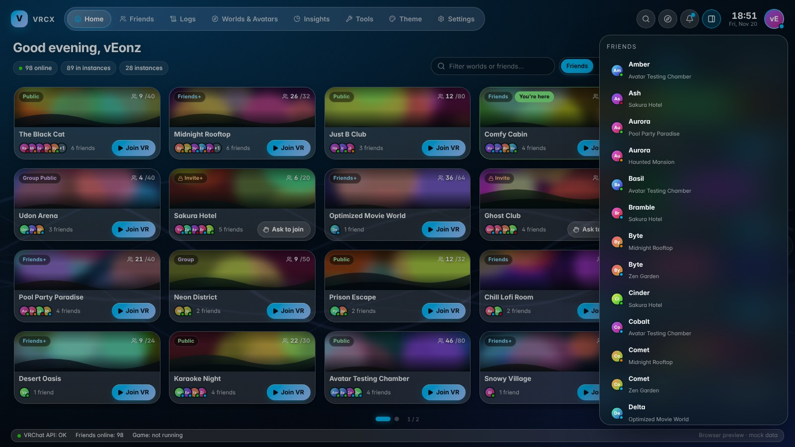

<div align="center">

# ✨ VRCX Launcher Theme

**A modern, console-style launcher theme for [VRCX](https://github.com/vrcx-team/VRCX).**
Glass panels, animated backgrounds, sliding pages, and a Home screen where you can see where your friends are and join them in VR with one click.

[**▶ Try the live preview**](https://veonz.github.io/VRCX-Launcher-Theme/) &nbsp;·&nbsp;
[**⬇ Download**](https://github.com/vEonz/VRCX-Launcher-Theme/releases/latest) &nbsp;·&nbsp;
[**How to install**](#-how-to-install)



</div>

> [!NOTE]
> This is an unofficial theme built on top of VRCX. It is not made by or affiliated with the VRCX team or VRChat.
> The UI was styled and written with the help of AI (Claude by Anthropic) and then tested and adjusted by hand.

---

## What it looks like

<div align="center">

</div>

<table>
  <tr>
    <td width="50%"><br><sub><b>Join in VR or desktop, self-invite, world details</b></sub></td>
    <td width="50%"><br><sub><b>Pages slide left and right, Wii-menu style</b></sub></td>
  </tr>
  <tr>
    <td width="50%"><br><sub><b>Theme Studio: presets, backgrounds, colours, glass</b></sub></td>
    <td width="50%"><br><sub><b>Logs tab: Friend Log, Game Log, Feed and more</b></sub></td>
  </tr>
  <tr>
    <td width="50%"><br><sub><b>Sakura preset (Bokeh background)</b></sub></td>
    <td width="50%"><br><sub><b>Aurora Glass preset</b></sub></td>
  </tr>
  <tr>
    <td width="50%"><br><sub><b>Sunset preset (PS3-style wave)</b></sub></td>
    <td width="50%"><br><sub><b>Your friends list as a slide-out drawer</b></sub></td>
  </tr>
</table>

<sub>Screenshots are from the browser preview, which uses made-up friends and generated world art. In VRCX you see real world thumbnails and avatars.</sub>

## Features

### 🏠 Home: your friends' instances as cards
- One card per instance your friends are in: **world thumbnail, world name, access type, region, live player count** (like `12/40`) and a row of **friend icons** with their status.
- **5 × 4 cards per page.** Pages slide left and right with the arrows, page dots, mouse wheel, click-and-drag, or the ← → keys.
- **Updates live** as friends move between worlds. Player counts refresh every 60 seconds (adjustable) or when you press refresh.
- Filter by world or friend name, and sort by friends, players or A–Z.
- The instance you're in is pinned first and marked **You're here**.

### ▶ One-click join
- **Join VR** launches VRChat in VR straight into that instance. If VRChat is already running, it sends you there in the running game.
- Switch to **Desktop** mode from the header, or pick it per card in the **⋯** menu.
- Invite-only instances show **Ask to join**, which sends an invite request to a friend who's inside.
- The ⋯ menu also has **self-invite**, **world details**, and VRCX's own **launch options and link** dialog.

### 🗂 Tabs and pages
**Home · Friends · Logs · Worlds & Avatars · Insights · Tools · Theme · Settings.** Each tab has its pages in a second row, and it remembers which one you were on.

| Tab | Pages |
| --- | --- |
| Friends | Locations, Friend List, Favorites, Players Here |
| Logs | Friend Log, Game Log, Feed, Notifications, Moderation |
| Worlds & Avatars | Search, Favorite Worlds, Favorite Avatars, My Avatars |
| Insights | Instance Activity, Mutual Friends, Hot Worlds, and your custom dashboards |
| Tools | All Tools, Gallery, Screenshots, Store |

**Every VRCX feature is still here.** The original pages and dialogs are reused as they are, with the same data, filters, exports and right-click menus, and restyled to match the theme.

The top bar has quick search (Ctrl+K), Direct Access, the notification centre, your friends list as a slide-out drawer, a clock, and your profile.

### 🎨 Theme Studio
- **7 presets:** Midnight Wave, Aurora Glass, Sakura, Nebula, Sunset, Immersive, Focus.
- **Animated backgrounds:** a PS3-style wave, Aurora, Nebula, Bokeh, **World art** (a blurred image of the card you're hovering), your own image, or a still Minimal gradient.
- **Accent colour, glass transparency, blur and roundness** sliders.
- **Animation speed** (set it to 0 to freeze the background and save GPU while you're in VR) and page transitions on or off.
- **Grid size** (columns and rows), refresh interval, and a 24-hour clock.
- **One switch back to the classic VRCX layout** if you ever want it.

---

## 🧪 Try the preview

**[veonz.github.io/VRCX-Launcher-Theme](https://veonz.github.io/VRCX-Launcher-Theme/)**

The preview runs in your browser with fake friends and instances, so you can click around, page through cards, try the themes and open the menus. Joining is simulated. Nothing connects to VRChat.

---

## 📦 How to install

The theme replaces VRCX's interface files. Your VRCX data, login, settings and database are not touched.

**You need:** VRCX for Windows, installed normally (version 2026.11.x; see [Compatibility](#compatibility)).

1. **Download** `VRCX-launcher-html.zip` from the [latest release](https://github.com/vEonz/VRCX-Launcher-Theme/releases/latest).
2. **Close VRCX completely**, including the tray icon (right-click it, then Quit).
3. **Open the VRCX install folder.** It's usually `C:\Program Files\VRCX`. You can also right-click the VRCX shortcut, then *Open file location*.
4. **Rename** the existing `html` folder to `html_original`. This is your backup, so don't delete it.
5. **Extract** the zip and copy its `html` folder into the VRCX install folder, next to `VRCX.exe`.
6. **Start VRCX** and log in. You'll land on the new Home screen.

> [!TIP]
> Windows may ask for administrator permission when you rename or copy inside `Program Files`. That's expected.

### Updating VRCX
VRCX updates replace the `html` folder with the official one. After an update, repeat steps 2–6 with a theme release that matches the new VRCX version.

### Uninstalling
1. Close VRCX.
2. Delete the theme's `html` folder.
3. Rename `html_original` back to `html`.

To get the classic look without uninstalling, go to **Theme → Use classic VRCX layout**. To come back, click **✨ Launcher layout** at the bottom of the window.

### Compatibility
This theme is built from VRCX source **2026.11.14**. The interface talks to VRCX's built-in backend, so a theme built for a very different VRCX version may not work properly. If something breaks after a VRCX update, uninstall the theme (see above) until a matching release is out, or build it yourself (below).

---

## 🛠 Build it yourself

You'll need **Node.js 24** and **npm 11**.

```bash
git clone https://github.com/vEonz/VRCX-Launcher-Theme.git
cd VRCX-Launcher-Theme
npm ci

npm run preview:launcher    # browser preview with mock data → http://localhost:9100/launcher/preview/index.html
npm run prod                # builds the full interface into build/html
npx vitest run src/launcher # tests for the instance cards
```

Copy `build/html` into your VRCX install folder as described in [How to install](#-how-to-install).

To build the whole app (including the .NET backend and installer), follow VRCX's [Building from source](https://github.com/vrcx-team/VRCX/wiki/Building-from-source) guide.

### Where the code is

```
src/launcher/
  LauncherLayout.vue        main window: background, top bar, pages, friends drawer, dialogs
  RootLayout.vue            switches between launcher and classic layout
  navigation.js             which pages live under which tab
  launcher.css              the glass theme (only active in launcher mode)
  components/               AnimatedBackground, LauncherTopBar, HomeScreen, InstancePager, InstanceCard, ThemeStudio
  composables/              useInstanceCards: groups friends by instance, loads world art and player counts
  theme/                    theme settings and presets
  views/                    Home and Theme pages connected to VRCX
  preview/                  the browser preview and its mock data
src/plugins/router.js       adds /home and /theme, and makes Home the start page
```

---

## Credits

- **[VRCX](https://github.com/vrcx-team/VRCX)** by pypy, Natsumi and contributors. All the real functionality is theirs. Their original README is kept in [README-VRCX.md](README-VRCX.md).
- Launcher theme by **vEonz**, styled and coded with the help of AI (Claude by Anthropic).
- Not affiliated with VRChat Inc. or the VRCX team. Please don't send theme bugs to the VRCX team; open an issue here instead.

## License

MIT, same as VRCX. See [LICENSE](LICENSE).
